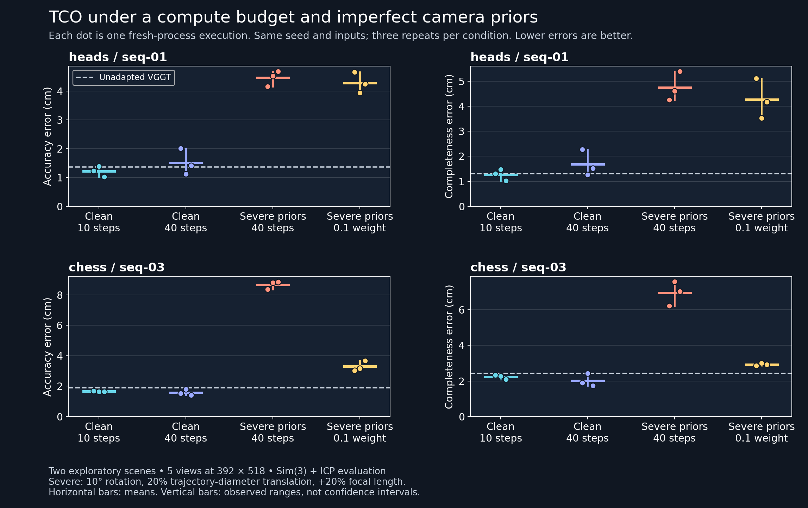

# Reliable test-time adaptation for 3D reconstruction

An independent research workspace for reproducing [TCO](https://github.com/cvlab-stonybrook/TCO) and studying when camera priors help or harm test-time adaptation. This is an exploratory study, not an official implementation or a claim of a new state of the art.

## Evidence so far

The initial five-sequence 7-Scenes subset showed mean aligned reconstruction accuracy error decreasing from **1.770 to 1.415 cm**, and completeness error from **2.056 to 1.629 cm**, after 40 TCO steps. This is partial reproduction on selected sequences, not reproduction of the full published benchmark.

Follow-up execution repeats exposed substantial variation: on Heads, clean 40-step adaptation harmed accuracy or completeness in 2 of 3 executions. Severe synthetic camera-prior corruption harmed all executions on the two inspected sequences. Three execution repeats with the same seed are not three independent optimization seeds. These observations motivate stronger baselines and reliability experiments; they do not establish a novel method.



Aggregate results are in [results](results/). See [reproduction boundaries](docs/REPRODUCTION.md), [third-party sources](docs/THIRD_PARTY.md), and frozen manifests. Historical runners are retained without methodological edits.

The [research plan](docs/RESEARCH_PLAN.md), [USD 200 budget](docs/BUDGET.md), and [implementation handoff](docs/IMPLEMENTATION_HANDOFF.md) define the next stages. The first new study is a precommitted 39-job learning-rate and visual-only baseline screen.

## Setup and use

Linux with CUDA is the reference execution environment. Local development uses an RTX 3080; full five-view 518-pixel adaptation was measured at about 11.5 GiB allocated memory on a 48 GB RTX 6000 Ada. The measured configuration does not fit a 10 GB 3080 without changing memory behavior. Reduced two-view 224-pixel runs are debugging only.

```bash
python scripts/setup_upstream.py
docker build -f environment/Dockerfile -t tco-research .
python scripts/download_assets.py --root /path/to/assets --scenes heads chess fire
```

Prepare the public dataset using the registration protocol linked in [THIRD_PARTY.md](docs/THIRD_PARTY.md), preserving original frame IDs. The local vectorized preprocessing utility is excluded because it derives from separately licensed SimpleRecon code. The public source and registration requirements are documented so a researcher can obtain it directly. No datasets, checkpoints, or external source trees are redistributed here. This setup fetches dependencies over the network; the hashed wheel inventory records our reference cloud environment, not a universal cross-platform lock.

With prepared data mounted at `/data` and this repository at `/workspace`:

```bash
python scripts/run_baseline.py --run-id example_heads_518_s40_seed42 \
  --data-root /data/data/7scenes --checkpoint /data/checkpoints/VGGT-1B \
  --scene heads/seq-01 --frames 0 200 400 600 800 --size 518 --steps 40 --seed 42
```

Each run starts a fresh model and records configuration, source/input hashes, finite gradients, timing, memory and evaluation results. It refuses to overwrite an existing run directory. Raw evidence remains local; public aggregates do not contain private cloud connection or billing information.

CPU validation:

```bash
python -m unittest discover -s scripts -p 'test_*.py'
```

NumPy is required for the CPU validation suite. GPU inference also requires the upstream dependencies and Dockerfile. There is no blanket license grant over upstream projects, datasets or checkpoints; consult their own terms.
