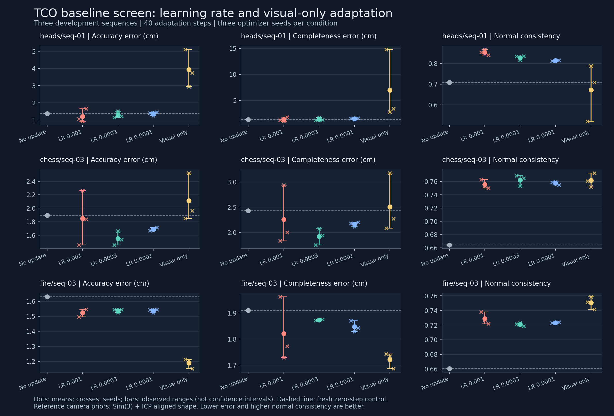

# Learning-rate and visual-only development screen

All 39 planned jobs completed: three fresh zero-step controls and 36 adaptations, totaling 1,440 optimizer updates. Each condition uses three optimizer seeds on Heads 01, Chess 03 and Fire 03. These are previously inspected development sequences.

Execution commit: `b060746b304c1fc0b82c60e2723202162cb1b42d`. Frozen manifest SHA-256: `60ec878ad7c4c9bb7b3a302bb1cc405d4140ef512eb3c99ae4e29cf07461b080`.

## Aggregate descriptive results

Relative error averages accuracy/base-accuracy and completeness/base-completeness, with equal scene weight. A value below 1 improves on the fresh unadapted control. Harm counts any run with accuracy OR completeness >1% worse than that control; this is a descriptive threshold, not a failure probability.

| Condition | Relative error | Accuracy cm | Completeness cm | Normal consistency | Adaptation and inference s | Harmful / 9 |
|---|---:|---:|---:|---:|---:|---:|
| Released LR 0.001 | 0.9473 | 1.528 | 1.797 | 0.7794 | 27.47 | 3/9 |
| LR 0.0003 | 0.9227 | 1.460 | 1.727 | 0.7705 | 27.61 | 1/9 |
| LR 0.0001 | 0.9698 | 1.531 | 1.829 | 0.7650 | 27.66 | 2/9 |
| Visual-only LR 0.0003 | 1.9969 | 2.410 | 3.736 | 0.7281 | 27.50 | 5/9 |

## Per-scene results

Observed seed ranges appear in the figure and machine-readable summary. Individual outcomes remain in per_run.csv.

| Scene | Condition | Accuracy cm | Completeness cm | Normal consistency | Relative error | Harmful / 3 |
|---|---|---:|---:|---:|---:|---:|
| heads/seq-01 | Released LR 0.001 | 1.213 | 1.314 | 0.8538 | 0.9453 | 1/3 |
| heads/seq-01 | LR 0.0003 | 1.291 | 1.385 | 0.8282 | 1.0012 | 1/3 |
| heads/seq-01 | LR 0.0001 | 1.368 | 1.473 | 0.8141 | 1.0628 | 2/3 |
| heads/seq-01 | Visual-only LR 0.0003 | 3.931 | 6.978 | 0.6721 | 4.1017 | 3/3 |
| chess/seq-03 | Released LR 0.001 | 1.850 | 2.257 | 0.7556 | 0.9527 | 1/3 |
| chess/seq-03 | LR 0.0003 | 1.550 | 1.922 | 0.7624 | 0.8048 | 0/3 |
| chess/seq-03 | LR 0.0001 | 1.689 | 2.166 | 0.7578 | 0.8916 | 0/3 |
| chess/seq-03 | Visual-only LR 0.0003 | 2.111 | 2.510 | 0.7617 | 1.0739 | 2/3 |
| fire/seq-03 | Released LR 0.001 | 1.523 | 1.821 | 0.7289 | 0.9438 | 1/3 |
| fire/seq-03 | LR 0.0003 | 1.538 | 1.873 | 0.7210 | 0.9620 | 0/3 |
| fire/seq-03 | LR 0.0001 | 1.537 | 1.848 | 0.7231 | 0.9549 | 0/3 |
| fire/seq-03 | Visual-only LR 0.0003 | 1.189 | 1.721 | 0.7505 | 0.8151 | 0/3 |

## Limits

This screen does not establish a new method, robustness to estimated/noisy priors, or held-out generalization. Three optimizer seeds coexist with unresolved execution variability. Scores use Sim(3)+ICP alignment and therefore do not establish absolute metric scale. Timings exclude one-time model load and offline reference evaluation; end-to-end deployment comparisons must state that boundary and include any extra matching/probes.

All runs have finite predictions/losses/gradients, unchanged tracked base-parameter version counters, matching declared inputs/source/configuration, and a clean precommitted research checkout. Missing or inconsistent evidence causes aggregation to fail rather than produce a partial mean.
