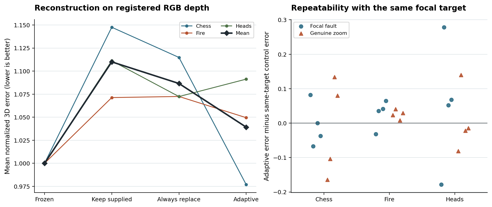

# Correct focal selection improved TCO, but frozen VGGT had the lowest 3D error

Across **72 full-model GPU executions**, adaptive focal selection reduced registered-RGB reconstruction error by **6.38% against TCO with the supplied metadata** and **4.35% against TCO that always replaces the outlier**. Its error was **3.92% higher than frozen VGGT**, the strongest registered comparator. Both optimizer seeds favored the frozen model. The experiment therefore missed its requirement of at least 5% improvement over the strongest comparator. The $25 MASt3R allocation remains reserved. [Registered criteria](../../docs/DENSE_FOCAL_PILOT.md) · [All scored executions](summary.json)

| Method | Registered RGB score | Registered accuracy, cm | Registered completeness, cm | Released-reference score |
|---|---:|---:|---:|---:|
| Frozen VGGT, zero updates | **1.0000** | **1.743** | **1.601** | **1.0000** |
| TCO, keep supplied focal | 1.1100 | 1.975 | 1.760 | 1.0660 |
| TCO, always replace the outlier | 1.0866 | 1.936 | 1.712 | 1.0436 |
| TCO, choose from the image and neighboring cameras | 1.0392 | 1.826 | 1.647 | 1.0064 |

Lower is better for both distances and the score. Each run's score averages its accuracy and completeness distances normalized by their respective frozen distances on the same input. The balanced design weights the three development scenes equally. Adaptive TCO's registered scores were **0.977 on Chess**, **1.050 on Fire**, and **1.091 on Heads**. Its scores by seed were **1.043 and 1.035**. Relative to frozen VGGT, the two distance components worsened by 5.34% and 2.51%. The released-reference comparison improved by 5.59% against keeping the supplied focal. That comparison passed its safeguard. [Scene, seed, condition and reference breakdowns](summary.json)

### What the camera correction achieved

The ordinary GPU camera head selected the correct physical focal target in all **24 adaptive executions**. This represents **six distinct focal faults and six distinct genuine digital zooms**, each repeated at two optimizer seeds. The 12 camera conditions share 15 source frames and three development sequences. Every decision agreed with the independent CPU FP32 head, and each subsequent loss call checked the actual target. The method adds no feature matcher. Mean instrumented inference and adaptation time across all executions was 53.84 seconds on the RTX 3090. [GPU decisions, configurations and optimizer traces](gpu_traces.zip) · [CPU replication on more camera positions](../relative_focal_windows/RESULTS.md)

We recovered each final camera from its own dense point-map coordinates and corresponding pixel locations. All **360 view fits** passed the existing pinhole test, with maximum reprojection error **0.000132 pixel**. We then compared their focal lengths with the physical focal values used to construct each intervention. On the affected view, mean absolute log-focal error was **0.00258** for adaptive TCO, **0.05733** for always replacing and **0.05810** for always keeping the supplied focal. The reduction against the better unconditional control was **95.5%**. This is a secondary camera measurement on these controlled digital changes. [Per-view fitted focal lengths and errors](camera_readout.json)

### How much can changing the focal decision explain?

The physically correct focal action yielded the better of the two independently executed unconditional endpoints in **22/24** condition–seed pairs on registered RGB depth. Even retrospectively choosing whichever of those two endpoints had the lower measured 3D error in each pair scored **1.0174**. Choosing on one seed and evaluating that choice on the other scored **1.0295**. The best attainable selection among these particular unconditional runs still missed the frozen score of 1.0000. In a separate post-hoc check, choosing the better of frozen and the actual adaptive endpoint in each pair scored **0.9840**, a 1.60% gain even with reference depth available for the choice. [Per-condition endpoint comparisons](focal_headroom.json)

Each adaptive execution had an independently run control with exactly the same focal targets, seed, initial points, initial adapter tensors and logged random states. All 24 pairs ended with different adapter and point tensors. Their median absolute registered score difference was **0.0583**, with a maximum of **0.2784**. Individual same-seed differences can therefore exceed the mean improvement over always replacing the outlier. Both scene count and run-to-run variation limit generalization. [Matched-target evidence](same_target_pairs.json)

### Numerical convention and scope

The primary experiment uses the original mixed-precision TCO execution. All coordinates in the **nine distinct frozen maps** were exactly representable in BF16. Only **0.0039–0.0117%** of coordinates in the 72 final maps lay on that grid. Exporting both as float32 preserves that difference. Registered normal consistency rose from 0.6850 for frozen VGGT to 0.7637 for adaptive TCO, but our prior arithmetic-only control showed that the point-coordinate grid itself affects normals. A future frozen-versus-adapted comparison should also report both endpoints unprojected at identical arithmetic precision. [Coordinate counts](point_precision.json) · [Arithmetic-only control](../pointmap_precision_v9/RESULTS.md)

The two depth references use the same measured axial depth under two camera conventions. These results cover controlled focal changes on three 7-Scenes development windows. Real zoom lenses, hidden changes with uniform supplied intrinsics, unseen scenes and transfer to another model require separate tests. The GPU completed 2,880 updates. Both drives hold all raw archives, and the provider confirmed shutdown at $0.00/hour. The calibration stage cost an estimated **$1.82 of $3**. [Timing, spending and checksums](session.json) · [Replay instructions](REPLAY.md)

The next local test preserves the frozen depth shapes and fits five view-specific depth scales from RGB correspondences under the selected focal priors. It starts by matching the arithmetic used to evaluate the frozen endpoint. [Redesign and comparison plan](../../docs/DEPTH_SCALE_REDESIGN.md)

A subsequent local control measured the effect of that arithmetic. Unprojecting the same frozen RTX 3080 outputs in float32 increased the registered distance score by **3.39%** and raised normal consistency from 0.6842 to 0.7608. Of 9.14 million local native point vectors, 555 differed from the archived RTX 3090 vectors. This supplies a within-device baseline for the redesign and qualifies the interpretation of the 3.92% gap in the original pilot. [Matched-precision results](../matched_focal_heads/RESULTS.md)
