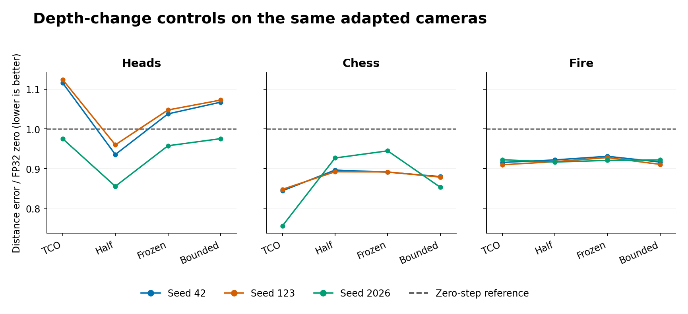

# Can limiting depth changes improve a TCO endpoint?

The 5% depth bound **did not pass** the frozen development screen. All 52 precomputed outputs were evaluated on CPU. They represent four methods applied to the same 13 completed trajectories. Primary results use only repeat 0: three public development sequences × three seeds. Four additional executions measure same-seed variation. No additional model training or rental time.

| Method | Normalized score ↓ | Harmful / 9 | Accuracy error (cm) ↓ | Completeness error (cm) ↓ | Normals ↑ |
|---|---:|---:|---:|---:|---:|
| FP32 zero (no adaptation) | 1.00000 | 0 | 1.6051 | 2.0319 | 0.75579 |
| Unchanged 40-step TCO | 0.93437 | 2 | 1.5115 | 1.7960 | 0.76791 |
| Keep half of each shape change | 0.91344 | 1 | 1.5490 | 1.7406 | 0.76332 |
| Keep initial shape, final cameras | 0.94992 | 4 | 1.6450 | 1.7426 | 0.75733 |
| Bound local shape change to 5% | 0.94164 | 2 | 1.5562 | 1.7983 | 0.76716 |

The best simple comparator by aggregate score was **half_shape**. Relative gain of the bounded candidate over this comparator was **-3.087%** (positive favors the candidate). The absolute score gain was -0.028201; the larger candidate/comparator same-seed range was 0.142656. Do not count repeats as additional independent scenes.

| Prespecified requirement | Outcome |
|---|:---:|
| At least 5% lower normalized error | Fail |
| No additional harmful cases | Fail |
| No scene score more than 1% worse | Fail |
| Gain exceeds observed same-seed range | Fail |

Accuracy and completeness are aligned nearest-neighbor distance errors. A case is harmful if either exceeds its matched-precision zero error by over 1%. All 13 unchanged TCO predictions are byte-identical to their input files. Their CPU distance metrics differ from the archived measurements by at most 1.3e-12 relative. Normal consistency is descriptive and not part of the gate.

Only final depth changes here: global depth scale, cameras and the original 40 updates are preserved. This experiment cannot show whether an in-loop depth constraint would change the learned cameras, whether estimated priors behave like these clean supplied priors, or whether the method works on another backbone or dataset. The gate is a budget decision, not a significance test.

[Formula and reproduction instructions](../../docs/DEPTH_TRUST_V11.md) · [Frozen manifest](../../manifests/depth_trust_v11.json) · [All 52 outputs and metrics](summary.json) · [Prediction hashes sealed before scoring](sealed_predictions.json)
