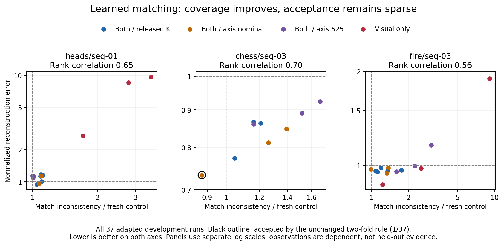

# Stronger image matching restores coverage, not a useful controller

The frozen CPU DISK–LightGlue baseline supplies eligible fixed support for **all three development scenes and all 37 adapted v6 runs**, compared with zero eligible coverage for SIFT. The unchanged provisional rule accepts **only 1/37 runs**. No threshold was loosened. This resolves a support bottleneck but does not validate an online method or release later spending.

| Scene | Retained pairs / matches | Fold match counts | Rank association with reconstruction error | Accepted / adapted | Harmful among accepted |
|---|---:|---:|---:|---:|---:|
| Heads | 6 / 632 | 344 / 279 | 0.648 | 0/14 | 0 |
| Chess | 7 / 1,328 | 645 / 683 | 0.700 | 1/9 | 0 |
| Fire | 10 / 2,453 | 1,207 / 1,246 | 0.565 | 0/14 | 0 |

All folds connect all five views. Fold counts exclude pair/fold fragments below ten matches, so they need not sum to all retained matches. The one accepted run is Chess, axis-aware nominal K, seed 42, repeat 0 (normalized error 0.733139). Zero harmful acceptances at this low acceptance count is not a reliable safety estimate.

Matching used only fixed RGB inputs, 2,000 maximum DISK keypoints, pretrained LightGlue and unchanged v6 geometric filtering, splitting, coverage and 2% two-fold acceptance thresholds. Every proxy score was saved before joining reference errors. All v6 labels had already been inspected before this follow-up was designed: these are exploratory development associations, not held-out validation or evidence of causation. Within-scene rank association does not prove useful absolute improvement relative to the unadapted model. A consistency score can miss common shape biases, and its current geometry-dependent scale normalization can be affected by shape changes.

CPU preparation took 75.97 seconds including model loading and matching, excluding the earlier dependency/weight download. Scoring and orchestration add cost. Concurrent local work means this is not a controlled speed benchmark. RunPod spending was **USD 0**. The separate local pose-precision study continues independently.

The next method question is whether the **marginal effect of a constraint group**, compared with an otherwise identical shared-gradient proposal, is more informative than requiring absolute improvement in this score. That is a new hypothesis requiring its own frozen intervention study. These results do not justify replacing the failed rule with a tuned threshold, claiming improved reconstruction, or advancing directly to MASt3R.

Protocol and provenance: [study design](../../docs/LEARNED_SUPPORT_V8.md), [frozen manifest](../../manifests/learned_support_v8.json), [support](support.json), [all proxy outcomes](fixed_match_proxy_validity.json). Matching execution commit: `7b0a30ca02d3a0ae6097bf195bf27c817087efcb`. The official [LightGlue repository](https://github.com/cvg/LightGlue) supplies the conventional pretrained components; they are not a contribution of this study.
