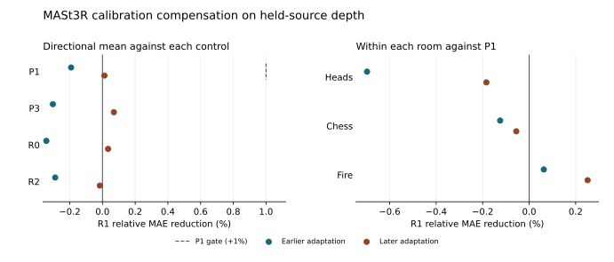

# Calibration-aware predictive LoRA in MASt3R

The bounded study ends with a negative development verdict. An accuracy improvement or a mechanism that survives dense confirmation remains unestablished. The evidence supports a reproducible account of the tested calibration mechanism and its limits. An accuracy improvement paper would need a new independently validated result.

## What the experiments tested

All comparisons freeze the original MASt3R weights. The first screen compares differentiating a fitted calibration solve with a forward-identical detached solver. The redesign compares a query-space calibration compensation penalty with trace-matched ordinary damping and a detached version of the same forward objective. The derivative, ridge convention and compensation penalty are defined in the method specification. [Original design](../../docs/FROZEN_LORA_ACCURACY_PLAN.md) · [Redesign](../../docs/PROFILED_COMPENSATION_REDESIGN.md)

The original 36-state experiment nominated neither P3 nor P4. The no-update diagnostic then measured attenuation of roughly 29–31% on the training path in the two folds of Heads/earlier, while the fitted-query improvement survived the FP32 path. That one adaptation case motivated the redesign. [Original screen](../lora_profiled_v1/held_source_scores.json) · [Calibration diagnosis](../lora_profiled_d1_v1/README.md)

| Original candidate | Earlier vs P1 | Later vs P1 | Common improving rooms |
|---|---:|---:|---|
| P3 | +0.111% | -0.058% | chess, fire |
| P4 | -0.364% | -0.144% | chess |

## Held-source development results

The redesign uses both adaptation directions for Heads, Chess and Fire. The support and query sets both influence adaptation. The opposite temporal packet is evaluated after the common prediction seal, with a fixed mask excluding adaptation pixel overlap. Each direction aggregates observations within views, averages the five views, then weights the three rooms equally. Both directions use the same three rooms. The primary MAE is measured after native alignment and the common final calibration. The secondary native endpoint is reported in the same metric gauge.

| Arm | Earlier calibrated | Later calibrated | Earlier native | Later native |
|---|---:|---:|---:|---:|
| P0 | 67.889 | 66.657 | 69.211 | 68.098 |
| P1 | 67.501 | 66.593 | 68.741 | 68.047 |
| P3 | 67.426 | 66.631 | 68.770 | 68.147 |
| R0 | 67.399 | 66.607 | 68.726 | 68.177 |
| R1 | 67.630 | 66.585 | 68.969 | 68.075 |
| R2 | 67.435 | 66.574 | 68.642 | 68.043 |

All table entries above are MAE in millimeters. The relative gains below use calibrated MAE with a positive value denoting an improvement over the designated control.

| R1 comparator | Earlier adaptation | Later adaptation |
|---|---:|---:|
| P1 | -0.192% | +0.012% |
| P3 | -0.303% | +0.070% |
| R0 | -0.343% | +0.034% |
| R2 | -0.289% | -0.016% |

| Room | Adaptation source | P1 MAE (mm) | R1 MAE (mm) | R1 reduction |
|---|---|---:|---:|---:|
| Heads | earlier | 43.621 | 43.925 | -0.697% |
| Heads | later | 43.620 | 43.700 | -0.184% |
| Chess | earlier | 98.137 | 98.260 | -0.125% |
| Chess | later | 93.857 | 93.909 | -0.055% |
| Fire | earlier | 60.744 | 60.706 | +0.063% |
| Fire | later | 62.301 | 62.145 | +0.251% |

Common rooms improving against P1 in both directions were Fire. The registered rejection checks report R1_did_not_pass_against_P1_earlier, R1_did_not_pass_against_P1_later, R1_did_not_pass_against_P3_earlier, R1_did_not_pass_against_R0_earlier, R1_did_not_pass_against_R2_earlier, R1_did_not_pass_against_R2_later, fewer_than_two_same_scenes_improve_over_P1_in_both_directions. The score report records 0 numerical failures.

R1 missed the prospective development gate. Dense confirmation, conditional mechanism ablations, independent-scene testing and VGGT transfer remain unrun. The single local redesign has been used.

The held-source measurement covers sparse depth on three development rooms. Both directions reuse those rooms. The mask and balanced averaging limit overlap and frame-count bias. Surface accuracy, completeness and cross-scene transfer require separate measurements.



## Mechanism, repeatability and cost

The shared first full-gradient step matched exactly across P3, R0 and R1 in all six conditions. R1 and R2 shared their first forward computation. The output-adjoint replay and parameter finite differences passed the real-model engineering check. Across 18 fresh P0, P1 and P3 controls, 18 matched both historical reconstruction endpoints, the frozen backbone fingerprint and each recorded adapter update exactly. The audit records every comparison against the original prediction seal. [Training audit](training_audit.json) · [Engineering bridge](engineering/bridge01/report.json)

The compensation norm below is the training residual change associated with re-fitting scale. The fold 0 value is measured before macro-step index 6 and the fold 1 value before macro-step index 7. Both use the last recorded pre-update loss for that fold. These are adaptation diagnostics and use the allowed packet.

| Arm | Fold 0 median compensation norm | Fold 1 median compensation norm |
|---|---:|---:|
| P3 | 0.038681 | 0.058639 |
| R0 | 0.060032 | 0.048543 |
| R1 | 0.054446 | 0.048772 |
| R2 | 0.044835 | 0.053750 |

The full versus detached held-source contrast measures performance on this development design. Evidence beyond repeat variation requires fresh-process dense repeatability confirmation. The comparison across official TCO, CAPA, Test3R and LoRA3D is methodological here since they use different objectives or input information. [Primary-source comparison](../../docs/PROFILED_COMPENSATION_RELATED_WORK.md)

| Arm | Verified cases | Median local case time (s) | Peak CUDA allocation (MiB) |
|---|---:|---:|---:|
| P0 | 6 | 122.0 | 3666.8 |
| P1 | 6 | 345.7 | 4358.7 |
| P3 | 6 | 328.5 | 4728.5 |
| R0 | 6 | 324.9 | 4728.5 |
| R1 | 6 | 325.7 | 4728.5 |
| R2 | 6 | 328.5 | 4730.0 |

The 36 frozen or trained redesign states used 2.96 summed local container hours and 240 optimizer updates. Peak CUDA allocation was 4730.0 MiB and peak reservation was 5290.0 MiB. Per-case wall times include model setup and launcher overhead. Rental compute cost attributable to the study is USD 0.00. [Budget ledger](../../docs/BUDGET.md)

## Next research question

A separate study could test whether the five-scale surrogate and native alignment favor different adapter updates. Measure directional agreement using finite differences of native-aligned depth error on fresh development scenes. If they disagree consistently, compare a differentiated version of the same native alignment with its forward-identical detached control at matched inputs and compute. Confirm any gain on independent surfaces.

## Reproduction

The execution manifest and evaluator were committed before scientific optimization. The prediction seal binds the endpoints before held-source score access. Local source-backed replay and an independent sample replay match the original decision. The public aggregate replay checks the entire 180-view table and gate arithmetic without needing sampled measurements, full predictions or weights. [Execution](../../manifests/lora_profiled_compensation_execution_v1.json) · [Evaluation](../../manifests/lora_profiled_compensation_evaluation_v1.json) · [Global seal](prediction_seal.json) · [Scores](held_source_scores.json) · [Source replay](source_replay.json) · [Independent replay](independent_replay.json) · [C/E backup](verdict_backup01.json)

```powershell
python scripts/replay_compensation_published_metrics.py
```
