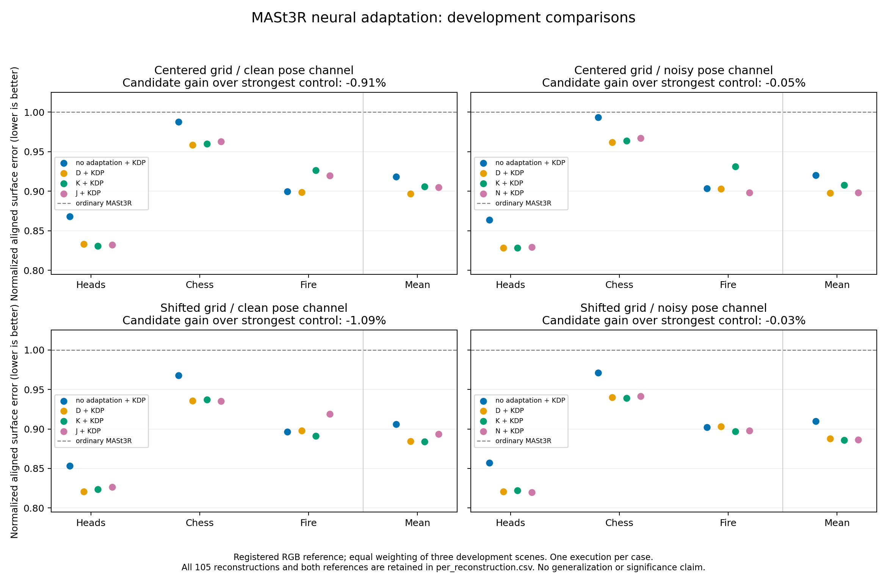

# MASt3R neural adaptation: development results

All 24 registered neural states, 960 updates, 105 reconstructions and 210 reference evaluations completed locally. The joint camera-supervised candidates did not outperform the strongest eligible controls. None of the four registered grid/pose-condition comparisons advances. This is a development result on three previously inspected sequences, not independent confirmation or a publishable-method claim.

## Main comparison

The primary score equally averages normalized accuracy and completeness over Heads, Chess and Fire. Ordinary MASt3R is 1 within each scene; lower is better. Gain is `1 - candidate/control`, so negative gain means higher error.

| Sparse grid | Pose channel | Joint candidate score | Strongest eligible control | Control score | Joint gain |
|---|---|---:|---|---:|---:|
| Centered | Clean | 0.904900 | D + KDP-clean | 0.896762 | -0.907% |
| Centered | Noisy | 0.898209 | D + KDP-noisy | 0.897724 | -0.054% |
| Shifted | Clean | 0.893631 | K + KDP-clean | 0.884012 | -1.088% |
| Shifted | Noisy | 0.886306 | K + KDP-noisy | 0.886075 | -0.026% |

D trains with sparse axial depth and cross-pair point consistency. K adds the own-camera intrinsic-direction term. J additionally uses clean cross-camera supervision; N uses the noisy pose packet. The primary candidates are J + KDP-clean and N + KDP-noisy. KD is depth/intrinsics-constrained geometric alignment; KDP adds relative-pose constraints. Thus D/K controls can still use supplied cameras during final alignment: they isolate camera supervision during neural adaptation, not removal of camera information from the entire system.

All four comparisons fail the 5% gain, no-scene-regression and alternate-reference checks. All pass the component-safety ceiling of at most 2% aggregate degradation per distance component. These are internal resource criteria, not significance tests. The released-reference candidate/control scores are respectively 0.917868/0.911344, 0.911424/0.910494, 0.908437/0.900050 and 0.900411/0.899761 in table order. Clean-pose oracles are excluded from noisy-channel control selection; all recorded oracle outputs remain visible as labeled ablations.

The joint candidates are 9.51–11.37% better than ordinary MASt3R, but that comparison combines neural adaptation with informative alignment constraints. Stronger same-input controls explain the apparent advantage. The best eligible D/K controls add about 2.37–2.63% over their matched zero-adaptation KDP alignments. This descriptive effect is worth understanding, but it is below 5%, selected within development, and lacks multi-case repeatability or new confirmation. It does not establish a novel camera-adaptation benefit.



All 210 accuracy/completeness rows are in [per_reconstruction.csv](per_reconstruction.csv). Full measurements, normal scores, reference identities, all arm/alignment combinations, scene gains, comparator eligibility and failed checks are retained in metrics.json, observations.json and scores.json.

## Execution, numerical variation and scope

The frozen [design](../../docs/MAST3R_NEURAL_TRANSFER.md) uses rank-4 adapters in 144 decoder attention modules, totaling 1,032,192 trainable parameters. Each update uses two ordered pairs sharing a reference image; five images participate in the fixed schedule. Frozen encoder features are cached, decoder training uses bfloat16 autocast and original heads stay float32. Final inference, updated descriptors/matches and alignment are recomputed in float32. Original weights/buffers retain their full state hash. All three zero-adaptation ordinary outputs exactly reproduce earlier native depth, intrinsic and camera arrays.

The complete primary GPU process took 4,479.37 seconds (74.66 minutes), with peak training allocation about 4.58 GiB on the RTX 3080. Concurrent CPU preparation prevents a controlled latency comparison. Training at 512 by 384 with sequential pairs is not simultaneous five-view rendering or the complete released TCO objective. Additional RunPod compute spending was USD 0; the USD 25 allocation remains reserved.

The [fixed fresh-process repeat](../mast3r_neural_repeat/README.md) failed exactness and registered native tolerances. Its surface-distance changes were small but measurable. One repeated Heads case cannot establish variation bounds for other scenes or conditions. In particular, the tiny noisy-channel ordering should not be interpreted as a reliable population difference.

The pose stress test changes only supplied poses while keeping RGB, K and sparse-range packets fixed. It is not an IMU experiment or a fully simulated noisy RGB-D sensor. Surface distances use the established similarity/ICP alignment; they do not establish absolute metric scale or SLAM trajectory accuracy. Camera diagnostics use nominal benchmark matrices. Previously evaluated holdouts and TUM targets cannot become untouched confirmation data for a redesign.

## Evidence and decision

Full states, point maps, native outputs and fresh matching caches are verified on two physical disks. Public adapter states, gauges, outputs, traces and sampled geometry support:

```sh
python scripts/replay_mast3r_neural_transfer.py
python scripts/replay_mast3r_neural_repeat.py
python scripts/score_mast3r_neural_repeat.py verify
```

These replay stored evidence and geometry, not an independently implemented dense evaluator or a new model execution. The exploratory [depth-family/matching audit](../../docs/MAST3R_DEPTH_FAMILY_AUDIT.md) passed its positive control; small shape changes and changed matches are mechanism clues, not accuracy or causal proof.

Pause at this analysis checkpoint as requested. Keep later rental funds reserved and the retained stopped workspace intact. The proposed next investigation is a validated geometry-versus-matching cache crossover before another training sweep, subject to explicit resume. See the [analysis handoff](../../docs/MAST3R_ANALYSIS_HANDOFF.md). Official Pow3R and Test3R preparation is complete, but neither has been benchmarked here. The overall publication goal remains unfinished.
