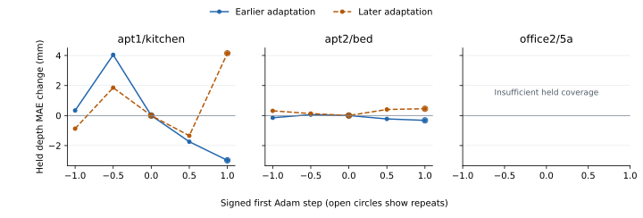

# MASt3R one-step LoRA directional test

One or more cases lacked a valid result. The registered screen is indeterminate.
The full step helped in 2 cases, worsened error in 2, fell within the repeat deadband in 0, and was invalid in 2.

Each sign is relative to the same initial LoRA factors. The primary metric is held-source axial depth MAE after fresh native MASt3R alignment and one metric scale fitted to the permitted adaptation samples. Negative depth changes favor the proposed step. The adaptation query contributed to training and is a diagnostic.

| Room | Adaptation source | Surrogate loss change | Half-step slope (mm) | Full-step slope (mm) | Held full-step change (mm) | Query full-step change (mm) | Directional class |
|---|---|---:|---:|---:|---:|---:|---|
| apt1/kitchen | earlier | +0.146399 | -5.788 | -1.660 | -2.983 | +0.056 | surrogate non descent |
| apt1/kitchen | later | +0.032049 | -3.200 | +2.508 | +4.145 | -0.037 | surrogate non descent |
| apt2/bed | earlier | -0.016185 | -0.286 | -0.087 | -0.321 | -0.055 | aligned |
| apt2/bed | later | -0.025213 | +0.272 | +0.069 | +0.452 | +0.026 | opposed |
| office2/5a | earlier | — | — | — | — | — | Invalid |
| office2/5a | later | — | — | — | — | — | Invalid |

The slope is the signed central difference at the stated scale, in mm per unit first Adam step. The realized change is the full step minus the zero state. The six cases share three rooms.

- office2/5a, earlier adaptation, view index 1 retained 0 held pixels after overlap exclusion.
- office2/5a, later adaptation, view index 1 retained 0 held pixels after overlap exclusion.



## Mean held depth error by adaptation direction

| Adaptation source | Initial MAE (mm) | After full step (mm) | Change (mm) |
|---|---:|---:|---:|
| earlier | — | — | — |
| later | — | — | — |

## Verification and scope

- Surrogate loss and its gradient both favored the actual step in 4 of six cases, including 2 of 4 cases with sufficient held coverage. The endpoint uses fresh FP32-tensor inference and a new match graph. The correspondence fingerprint changed between the initial and full-step states in 4 cases.
- The independent replay verified 210 published held-view rows and 420 held and adaptation-query view errors from local arrays. It also recomputed the metric scale and checked the held coordinate hashes.
- Scientific launches used 1.20 summed local hours on the RTX 3080 and USD 0 rental compute.
- Within valid cases, the smallest held view had 54 samples and the largest absolute repeat difference was 0.000000 mm. Valid cases contributed 28 of the 42 completed native endpoint captures.
- The three rooms contribute sparse, viewpoint-shared depth checks at one initialized LoRA step. This experiment leaves later steps, dense surfaces and independent datasets open.

[Prospective protocol](../../docs/NATIVE_LORA_DIRECTIONAL_TEST_HANDOFF.md) · [Execution manifest](../../manifests/native_lora_direction_execution_v1.json) · [Prediction seal](prediction_seal.json) · [Scores](held_source_scores.json) · [Independent replay](independent_replay.json)

## Replay

The aggregate command needs only the public JSON files and Python. The private flag also evaluates the sealed local native predictions and depth packets.

```powershell
python scripts/replay_native_lora_direction.py
python scripts/replay_native_lora_direction.py --private
```
