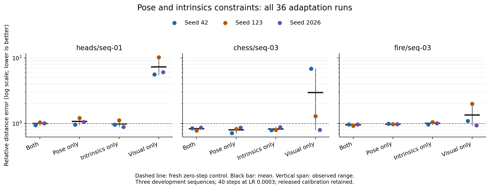

# Pose and intrinsics ablation: 39 validated runs

Completed 2026-11-11 KST. All **39 planned jobs / 1,440 adaptation updates** completed and passed remote and independent local validation. The raw archive is checksummed and backed up on two local drives. The experiment GPU is stopped, with no persistent volume on the new pod.

**Keeping both camera penalties had the best aggregate score.** Globally removing either penalty did not improve this development screen. Scene-dependent differences exist, but they do not yet justify a new selection method or a publication claim.

## Controlled comparison

Three development sequences, three seeds (42, 123, 2026), four conditions and three fresh zero-step controls. Every adapted run used five fixed frames at 392 x 518, 40 Adam updates at LR 0.0003, and visual weight 0.2. Pose and intrinsics weights were independently switched between their released values (1 and 0.01) and zero. A new process/model/optimizer was used for every run. All 39 jobs ran on one physical NVIDIA A40.

The primary score is the average of accuracy/control accuracy and completeness/control completeness, with equal scene weight. Lower is better; 1 is the fresh zero-step control. A harmful execution means **either** distance metric worsens by more than 1%, so a score below 1 can still be flagged. These are empirical counts from three seeds per scene, not population failure probabilities.

| Condition | Relative error score | Accuracy (cm) | Completeness (cm) | Normal consistency | Harmful / 9 |
|---|---:|---:|---:|---:|---:|
| Both | **0.9269** | **1.468** | **1.726** | 0.7720 | **2** |
| Pose only + visual | 0.9506 | 1.483 | 1.767 | **0.7734** | 5 |
| Intrinsics only + visual | 0.9391 | 1.470 | 1.777 | 0.7717 | 3 |
| Visual only | 3.8740 | 4.957 | 7.332 | 0.6601 | 8 |

Both penalties reduced the prespecified score by 7.31% relative to zero-step inference. Pose-only and intrinsics-only scores were respectively 2.55% and 1.31% higher than the both-penalty score. The small differences among camera-prior settings are descriptive, not statistically established rankings. Pose-only had slightly higher mean normal consistency.

## Scene means and observed ranges

Each cell below is a mean followed by the minimum–maximum across three seeds. Ranges are not confidence intervals.

| Scene | Both | Pose only | Intrinsics only | Visual only |
|---|---:|---:|---:|---:|
| Heads seq-01 | 0.9963 [0.9469–1.0376] | 1.0732 [0.9576–1.2080] | **0.9865** [0.8857–1.1157] | 7.3049 [5.6164–10.2405] |
| Chess seq-03 | 0.8317 [0.7817–0.8665] | **0.7996** [0.7101–0.8671] | 0.8231 [0.7886–0.8808] | 2.9752 [0.7949–6.8381] |
| Fire seq-03 | **0.9527** [0.9221–0.9683] | 0.9789 [0.9730–0.9905] | 1.0076 [0.9705–1.0451] | 1.3420 [0.9349–1.9949] |

Both beat pose-only in all three matched seeds on Heads and Fire. Both beat intrinsics-only in all three matched seeds on Fire. Chess's mean pose-only advantage and Heads' mean intrinsics-only advantage were not consistent across all matched seeds. The paired contrasts and their observed ranges are included in [summary.json](summary.json).

As a **post-hoc diagnostic using evaluation ground truth**, choosing the best mean condition separately for each scene yields score 0.9129, only **1.51% below** the global both-penalty score. This is a restricted oracle over these four settings and three scenes, not a deployable selector or a bound on every possible adaptive method. It is weak motivation for a complex scene-level selector at the current settings.

The factorial interaction `both - pose_only - intrinsics_only + visual` has mean 6.2415 on Heads, 2.1843 on Chess and 0.3082 on Fire. Large positive values are driven substantially by visual-only failures and show nonadditivity on this score. They do not prove gradient conflict; gradient directions were not measured in this batch.

## What did not repeat from v4

The earlier visual-only benefit on Fire did not reproduce here. Its mean accuracy/completeness were previously 1.189/1.721 cm; this batch measured 2.374/2.331 cm, with all three executions harmful under the declared rule. Chess visual-only also varied substantially, from score 0.7949 to 6.8381. All these outcomes are retained.

The previous batch used an RTX 6000 Ada; this one used an A40 because the retained GPU and automatic migration had no capacity. The device, CPU and driver environment changed, and execution variability was already unresolved. This comparison cannot isolate a hardware effect, a numerical effect or another source of variation. The fresh controls also differ slightly between studies. Never pool the v4 and v5 numbers into a single controlled comparison or claim that the earlier Fire observation is reliable.

## Calibration findings

The local and cloud audits agree on all 15 selected input frames and their hashes. The experiment deliberately retained released calibration and reference geometry.

- The registration implementation uses RGB focal length 525 pixels; the released loader uses 554.256 pixels, 5.57% higher. This is a source/protocol discrepancy, not an independent measurement of physical calibration.
- The image resize has different x/y scale factors, while the released intrinsic transform uses one common factor. Relative to the image affine, fx differs by 0.90%, cx by 2.337 pixels, and the largest tested image-coordinate displacement is 4.662 pixels.
- The model decoder fixes the principal point at the image center. A separate CPU derivative test verifies that its disagreement with the supplied principal point adds a constant weighted loss of approximately 0.00291 with zero encoding gradient. This constant alone does not explain harmful updates. The focal loss is Smooth L1 in pixels, so its scale depends on resolution.

See the [protocol and full calibration explanation](../../docs/PRIOR_ABLATION_V5.md), [15-frame audit](../calibration_v5/summary.json), [parameterization check](../calibration_v5/parameterization.json), and [explicit CRLF/LF source-hash mapping](../calibration_v5/source_line_endings.json). Windows and Linux raw hashes are preserved; only verified line-ending differences are accounted for.

These findings do not demonstrate that corrected calibration improves reconstruction. A corrected-calibration experiment needs common evaluation targets across competing input settings, explicit reference-geometry accounting, and fresh zero-step controls. Sim(3) plus ICP metrics assess aligned shape, not absolute scale or SLAM drift.

## Decision

Retain both penalties as the current default. Do not advance globally dropping pose or intrinsics as the principal contribution. Do not base a controller on the earlier Fire visual-only result.

The next bounded stage should first separate repeatability from calibration effects: locally reevaluate identical saved predictions, then run a small precommitted same-device/same-seed repetition study and a separate calibration-input study with common fixed reference targets. Use numerical and geometric checks before tuning a new gate. If a meaningful signal survives, test uncertain/estimated priors and held-out scenes; MASt3R transfer follows that gate. No extra cloud experiments beyond the frozen 39 were launched in this session.

## Validation, runtime and cost

- Local preparation: 21 unit tests, six reduced-input RTX 3080 integration runs, projection/convention checks, and a separate derivative audit. The zero-step smoke predictions were bitwise invariant to camera-loss switches.
- Full-resolution validation: all 39 planned records, 36 x 40 loss/gradient histories, finite point maps, independent weights, optimizer LR, unchanged base-parameter version counters, identical per-scene input/reference hashes, and one physical GPU. Local and remote aggregates match exactly.
- Experiment duration: **50.89 minutes**, within the 70-minute deadline. Median inference/adaptation time for a 40-step run: **52.44 seconds**, excluding model loading and evaluation. Maximum allocated GPU memory: **11.50 GiB**.
- Estimated rental cost including setup and collection: **USD 0.66**, within the USD 3 session cap and USD 200 overall budget. The observed account-balance change was also USD 0.66; delayed billing and existing storage mean it is not a settled invoice.
- The new A40 pod is stopped at **USD 0.00/hour** with no persistent volume. The pre-existing stopped 20 GB workspace remains, approximately USD 0.13/day; it was not deleted.

Execution commit: `568f92b7a5e6af982f3b3872a53928398db7688d`. Frozen manifest SHA-256: `5cefa44d45482fffaffab6d15e92891592c6791d860e8dcc23a1dc844b18f957`.

Raw archive: 459,808,460 bytes. SHA-256: `0a318379fa972e479c0b84ee46725fb5872585450cafe0e2b41df7002d17514a`. Public Git contains aggregates and analysis code; datasets, checkpoints, raw archives, account details and endpoints remain excluded.

Files: [all 39 executions](per_run.csv), [all 1,440 logged updates](per_step_losses.csv), [groups and paired contrasts](summary.json), [local integrity validation](local_validation.json), [execution and budget record](execution.json).
