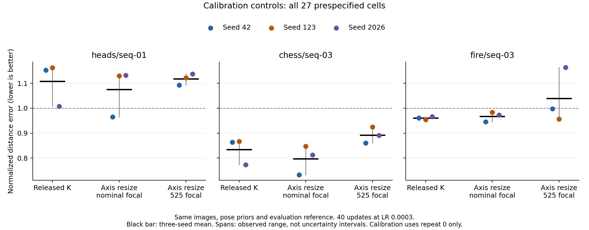
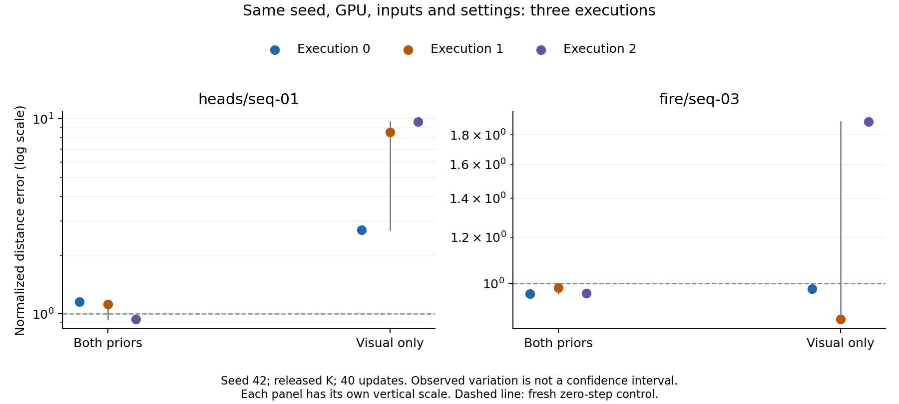

# Repeatability and controlled calibration: primary results

All **40/40 jobs and 1,480 updates completed**, with complete local evidence validation and a checksum-verified raw archive on two local drives. Neither calibration alternative passed the frozen development gate. Later MASt3R, held-out/cross-dataset and independent-verification spending remains withheld, as requested.

## Controlled calibration

Each condition contains the same three development sequences and optimizer seeds 42, 123 and 2026, five 518-pixel views, 40 steps, LR 0.0003 and both camera penalties. Only the supplied intrinsics prior changes. All primary metrics use the unchanged released evaluation reference; repeat 0 is used for all 27 calibration cells. Lower normalized score is better; 1 is the fresh zero-step control. A harmful cell has accuracy **or** completeness error more than 1% above its fresh control.

| Supplied K | Normalized distance score | Relative gain versus released K | Harmful cells | Mean accuracy error | Mean completeness error | Normal consistency |
|---|---:|---:|---:|---:|---:|---:|
| Released | 0.967409 | — | 3/9 | 1.5115 cm | 1.7960 cm | 0.767910 |
| Axis-aware resize, nominal focal | 0.946657 | +2.145% | 3/9 | 1.4805 cm | 1.7524 cm | 0.771226 |
| Axis-aware resize, 525 focal | 1.016178 | −5.041% | 5/9 | 1.6348 cm | 1.8531 cm | 0.766951 |

The nominal resize change fails the prespecified 5% gain and repeat-variation criteria. Its absolute score gain is 0.020752, versus a maximum observed both-prior same-seed range of 0.210784. The 525-focal change fails all four criteria, including harm and per-scene regression. These conservative resource gates are not significance tests. Calibration repair alone would not establish a novel method even if it passed.

## Identical-seed execution repeats

| Scene / objective | Three scores, seed 42 | Observed range |
|---|---|---:|
| Heads / both priors | 1.152868, 1.122816, 0.942084 | 0.210784 |
| Heads / visual only | 2.700317, 8.550955, 9.702695 | 7.002378 |
| Fire / both priors | 0.960574, 0.983911, 0.961780 | 0.023338 |
| Fire / visual only | 0.980022, 0.869068, 1.897170 | 1.028102 |

All four groups have identical captured initial predictions, initial adapters and RNG states at every recorded phase, but different final adapters and pointmaps. First scalar losses agree; total losses first diverge at step index 1, after one update. This narrows the issue to execution/optimization and does not identify a particular GPU operator. Three repeated executions are not three independent optimization seeds or a population confidence interval.

The separate [24-evaluation CPU study](../evaluation_stability_v6/RESULTS.md) found stable distance and normal metrics for four saved predictions. It does not prove evaluator stability for all inputs: the bitwise-identical Heads zero prediction differs from v5 in normal consistency by about 2.29e-5 while its distance metrics agree to roughly 5e-15 m. No blanket determinism or hardware-causation claim is justified.

## Mechanism and validation checks

Fixed-prediction counterfactuals along the nine released-K trajectories show that axis-aware nominal resize changes 30.25–44.5% of focal Smooth-L1 component slopes; the 525 choice changes 69.5–91.5%. Thus the changed K is not uniformly gradient-inert. These values reuse the **same observed predictions** and do not simulate alternate optimization trajectories. Principal-point penalties remain constant under the current camera parameterization.

The image-only fixed-match proxy, prepared before inspecting v6 outcomes, abstained on **all 37 adapted runs** because its frozen support/coverage rules were not met. Zero harmful acceptances therefore means zero coverage, not a successful reliability controller. Thresholds were not relaxed after observing outcomes. See [proxy evidence](fixed_match_proxy_validity.json) and [local redesign diagnostics](../../docs/LOCAL_REDESIGN_DIAGNOSTICS_V6.md).

The separately frozen common-reference sensitivity analysis completed **40/40 CPU evaluations**. All conditions, including zero controls, use the same axis-aware 525-focal reference. Recovering the original reference before reprojection agreed within 4.44e-16 m. This is an alternative calibration assumption, not independently measured physical truth.

| Adaptation K | Score under alternate common reference | Harmful cells |
|---|---:|---:|
| Released | 0.985048 | 3/9 |
| Axis-aware nominal | 0.954493 | 3/9 |
| Axis-aware 525 | 1.000612 | 5/9 |

The nominal change gives 3.102% relative gain here, still below 5%; the 525 variant is 1.580% worse. These metrics are **not pooled with or substituted for the primary results**. The failed primary gate remains unchanged. All per-run sensitivity outcomes are in [reference_sensitivity.json](reference_sensitivity.json).

## Provenance, budget and limits

- Execution commit: `a709dbbcb91a0f7a79771512e8d269f2250cd6bd`.
- Frozen manifest SHA-256: `e7365af9a0d91596647cf84f5ebc35c257e81bf6dd917f567750d91850be330a`.
- Raw archive SHA-256: `e43394622aa8499a1f9c0a19608f4e1d284c3e7d01fa6fe2c60ffa2cd0c33409` (1,333,329,598 bytes).
- One physical A40; median instrumented adaptation/inference 53.44 s, peak allocation 11.50 GiB. Capture overhead prevents an uninstrumented speed claim.
- Approximately **USD 0.72** including setup and collection, under the USD 3 cap. The rounded balance delta is not a settled invoice. The experiment pod is verified stopped at USD 0/hour; no persistent volume was added. The older retained volume remains approximately USD 0.13/day.
- One setup path-resolution failure occurred before experiments; its recovery logs are retained. No experiment job failed or was retried.
- CPU-derived evidence has a separate two-drive archive, SHA-256 `ae4cee18d7dca4755fb78918cc2dda936de924f44ff85ebccade1d07765029ad` (89,936 bytes). The original GPU archive is unchanged.

These are three inspected development sequences with reference camera priors and aligned shape metrics. They do not demonstrate held-out generalization, metric-scale recovery, a full benchmark reproduction, a new state of the art or a publishable improvement. All row-level outcomes, losses and gate checks are in [summary.json](summary.json), [per_run.csv](per_run.csv) and [mechanism_diagnostics.json](mechanism_diagnostics.json).
