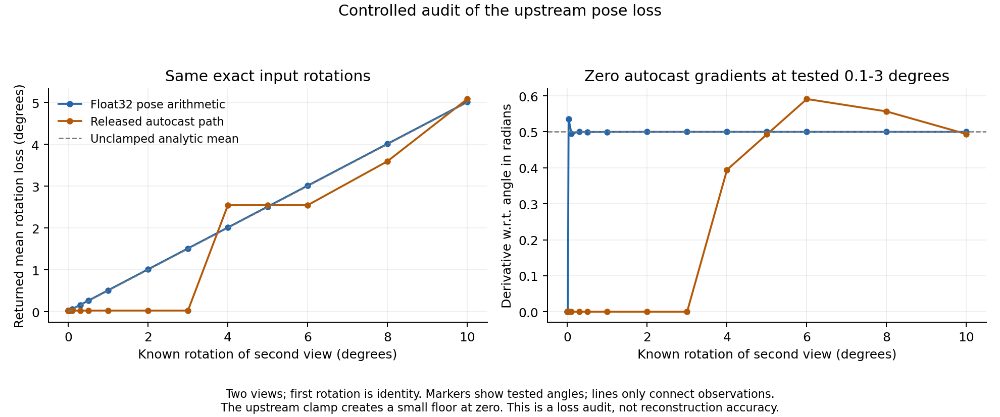

# Mixed precision can erase the small-angle pose gradient

For known exact rotations, the unchanged upstream pose loss under CUDA bfloat16 autocast returned **zero angle gradients at every tested angle from 0.1 to 3 degrees**. Disabling autocast for pose-loss arithmetic retained derivatives near the analytic value of 0.5 for the two-view mean. At 4 degrees, autocast produced a different loss and derivative; this is not simply a uniform rescaling.

The input pose matrices and returned scalar loss are float32 in both modes. That does not prevent intermediate matrix products from being rounded under the outer autocast context. Computing `acos` in float32 afterward cannot recover information already lost. Near identity, `1-cos(theta)` is approximately `theta^2/2`, so trace-based angle recovery is particularly sensitive to rounding. A generic error scale in the recovered angle is proportional to the square root of the matrix-product rounding scale; the exact threshold depends on the rotations, multiplication and accumulation path. Do not treat the sampled 3-degree observation as a universal cutoff.

The released clamp deliberately creates a small positive loss floor at zero even in float32. The audit preserves that clamp and the original loss function. These results do not prove improved reconstruction accuracy or identify all sources of adaptation nondeterminism.

The [pipeline preflight](../pose_precision_v7_preflight/summary.json) then ran four fresh local jobs: zero and two updates, with released and float32 pose arithmetic. The zero-step pointmaps were bitwise equal, and the first pose-loss input matrices were bitwise equal. On those same first inputs, rotation loss changed from **0.26513776 to 0.25976014 radians** and normalized translation loss from **0.38409418 to 0.38352334**. All updates completed. The intervention affects direct pose-loss arithmetic, including its pose canonicalization and translation operations; it does not change the backbone/head precision, intrinsics loss, renderer, optimizer or loss weights.

This is a concrete engineering baseline to test before a more elaborate reliability controller. A float32 repair alone is not a demonstrated novel publication contribution. Full-resolution, multi-seed accuracy and same-seed repeat comparisons remain pending; later rental allocations stay gated on reliable improvement.

See [all analytic controls](summary.json), [audit source](../../scripts/audit_rotation_precision.py), and [explicit intervention wrapper](../../scripts/run_pose_precision.py). Historical reproduction code and the running frozen calibration study are unchanged.
